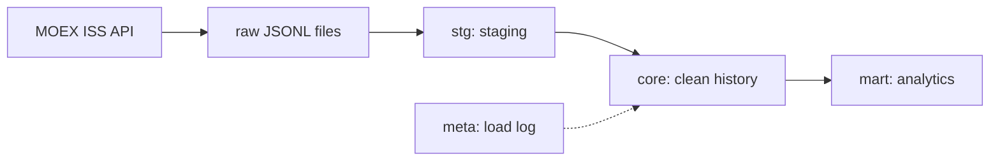

# moex-elt

An ELT pipeline that loads daily trading results for Moscow Exchange shares
(board TQBR) from the public MOEX ISS API into PostgreSQL, keeps a clean
historical layer and builds analytical marts on top of it.

Built as a learning project to practise production-style data engineering:
layered storage, incremental and idempotent loading, data quality checks.

## Architecture



| Layer | Storage | Purpose |
|-------|---------|---------|
| raw   | `data/raw/<dataset>/<board>/<date>.jsonl` | Exact copy of API responses; allows reloading without calling the API again |
| stg   | `stg.*` | All source columns as `TEXT`; replaced on every load |
| core  | `core.*` | Typed, deduplicated history with natural primary keys |
| mart  | `mart.*` | Ready-to-query tables for analysts and dashboards |
| meta  | `meta.load_log` | Journal of load attempts; source of the watermark |

## Data model

| Table | Grain | Description |
|-------|-------|-------------|
| `core.daily_quotes` | security × trade date | Daily OHLC prices, volume and turnover |
| `core.securities` | security | Current reference data: type, listing level, lot size, ISIN |
| `mart.daily_returns` | security × trade date | Daily return vs the previous trading day, enriched with reference data |
| `mart.market_daily` | board × trade date | Market breadth for shares: advancers, decliners, turnover, mean and median return |
| `mart.top_movers` | period × direction × rank | Top 10 gainers and losers among level 1 shares for 1 week, 1 month and 3 months |

## How it works

- **Incremental loading.** Each run continues from the last successfully
  loaded date recorded in `meta.load_log` (the watermark) up to yesterday.
  Today's session is never loaded because it is not complete yet.
- **Idempotency.** Core tables are loaded with `INSERT ... ON CONFLICT DO UPDATE`,
  so any date can be reloaded safely. Raw files are written atomically.
- **One transaction per trade date.** A failed date does not affect dates
  already loaded. The run stops at the first failure, so the watermark never
  skips a gap; the next run retries from the failed date.
- **Reference data as a snapshot.** Securities are refreshed on every run and
  upserted (SCD Type 1). Rows are never deleted: delisted securities keep
  their history, and `last_seen_date` shows when they were last listed.
- **Marts are fully rebuilt.** Window functions make mart rows depend on
  each other (a return depends on the previous day's price), so an
  incremental upsert could leave stale rows. A full rebuild is cheap at
  this data size and always consistent with core.
- **Write-audit-publish.** Marts are rebuilt and checked in a single
  transaction. If any data quality check fails, the transaction is rolled
  back and users keep seeing the previous, valid version.

## Data quality checks

Each check in `sql/checks/` is a query that returns violating rows;
an empty result means the check passed.

| Check | What it catches |
|-------|-----------------|
| `core_daily_quotes_valid_prices` | Non-positive close prices or `low > high` |
| `load_log_success_without_rows` | Weekdays logged as successful but with no rows in core |
| `mart_daily_returns_matches_core` | Rows lost or duplicated between core and the mart |
| `core_securities_missing_for_last_day` | Too many traded securities missing from the reference table |

## Getting started

Requirements: Python 3.12+, PostgreSQL 14+.

```bash
git clone git@github.com:DrMozq/moex-elt.git
cd moex-elt
python -m venv .venv
source .venv/bin/activate
pip install -r requirements.txt

cp .env.example .env      # fill in database credentials
```

```bash
python -m app init                                    # create schemas and tables
python -m app run --from 2026-07-01                   # initial load from a date
python -m app run                                     # daily incremental run
python -m app run --from 2026-09-01 --to 2026-09-30   # reload a period
python -m app -v run                                  # debug logging
```

Exit codes: `0` success, `1` pipeline failure, `2` invalid arguments.

## Project structure

```
app/
├── __main__.py        CLI entry point
├── pipeline.py        orchestration: ingest, marts, checks
├── config.py          settings from .env and project paths
├── db.py              connection handling and SQL file execution
├── state.py           load log and watermark
├── checks.py          data quality checks runner
├── errors.py          exception hierarchy
├── extract/           HTTP client with retries, MOEX API, raw files
├── load/              staging loader (COPY)
└── transform/         core upserts and mart rebuilds
sql/
├── ddl/               table definitions
├── transform/         stg → core
├── mart/              core → mart
└── checks/            data quality checks
```

## Possible improvements

- Unit tests with pytest for date selection, pagination and raw file I/O
- Scheduling with Airflow instead of manual runs
- SCD Type 2 history for reference data, built from daily raw snapshots
- Incremental rebuild of marts (recompute only the recent tail) for larger volumes
- Making a reference data failure non-blocking for the history load